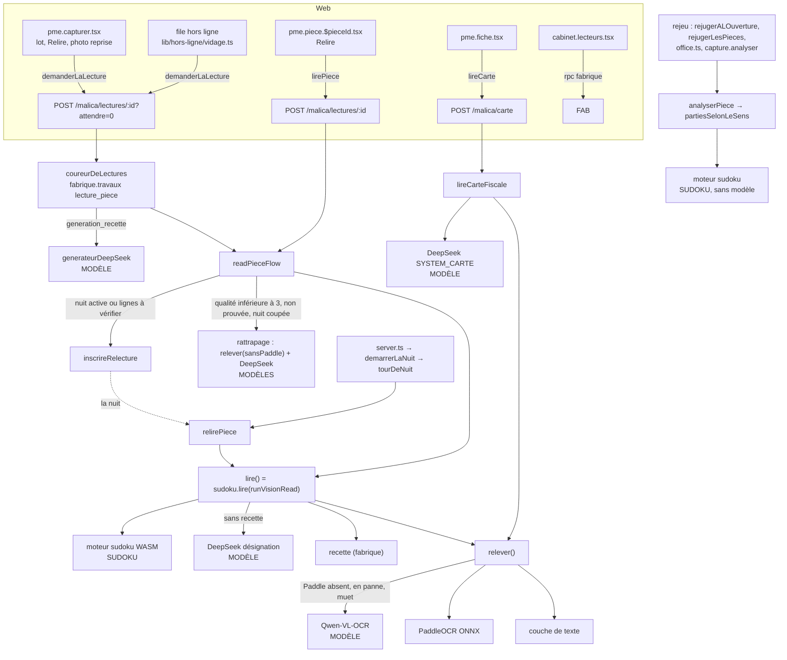

# Audit de la chaîne de lecture — l'ancien chemin, ses appelants, et comment le retirer (6 novembre 2026)

Vague « cartographier et planifier ». **Rien n'est supprimé ici.** Base : `audit/lecture`,
issue de `origin/claude/mission-production-ready`, qui contient `eb004c1c`. Lecture du code
seulement : aucune suite de tests lancée, aucun appel à un fournisseur de modèles, aucune base
touchée. Ce qui n'a pas été exécuté est marqué **INCERTAIN**, avec la commande qui trancherait.

## 0. Le constat qui cadre tout le reste

Le « nouveau chemin » n'est **pas encore** la lecture de jour. En production, chaque pièce
passe aujourd'hui par les **deux** chemins, l'un après l'autre (`read-flow.ts`, `preparer` →
`lire`) :

1. relevé `relever()` : couche de texte du PDF → PaddleOCR (ONNX, CPU) → **Qwen-VL-OCR** si
   Paddle est absent, en panne ou muet ;
2. désignation `runVisionRead` : **recette** de la fabrique si une recette active couvre la
   signature du plan, sinon **DeepSeek** (`deepseek-chat`, rôle `chat`). Elle a lieu **pour
   chaque pièce**, même quand le moteur va la prouver ;
3. `sudoku.lire()` : le moteur juge la lecture. En mode `designe` (le défaut du pack depuis
   `20261117095000`) et sur une pièce **prouvée**, `selectionParLeSudoku` remplace les totaux,
   les lignes de TVA, les droits, les articles prouvés, le nom de l'émetteur et les matricules
   prouvés. **Tout le reste reste désigné par le modèle** : `document_date`, `currency`, les
   autres `references` (numéro de facture…), l'émetteur non prouvé, et **toute** la pièce quand
   elle n'est pas prouvée ;
4. rattrapage : si la qualité est < 3, la pièce non prouvée et `lecture.relecture_nuit` =
   `coupee` (**le défaut**), un second relevé **Qwen** + une seconde désignation DeepSeek
   partent tout de suite ; sinon ils sont inscrits pour la nuit.

Le banc sans IA (`banc-sans-ia.ts`) mesure, lui, la sortie du moteur **seule** : il n'appelle
pas `runVisionRead` et ne construit pas l'extrait `extract.v1`. Ses chiffres disent ce que le
moteur sait affirmer. Ils ne disent pas ce que la production rend aujourd'hui.

## 1. La définition exacte de l'ancien chemin

### 1.1 Modules et fonctions

| Fichier (`apps/api/src/…`)                               | Ce qui appartient à l'ancien chemin                                                                                                                                                                                                               | Ce qui est partagé avec le nouveau                                                                                                                                                                                                         |
| -------------------------------------------------------- | ------------------------------------------------------------------------------------------------------------------------------------------------------------------------------------------------------------------------------------------------- | ------------------------------------------------------------------------------------------------------------------------------------------------------------------------------------------------------------------------------------------ |
| `malica/lecture/vision.ts`                               | `runVisionRead` (passe 2), `SYSTEM_SELECT`, `SelectionResponse`, `selectionDepuisReponse`, `planBorne`, `withRetry`, `toRef`, `labelText`, `lireUnePage` (Qwen par bandes), `visionDisponible`, la bascule Paddle → vision dans `releverDesPages` | `relever()` (couche de texte + Paddle + recollage), `laCoucheSeCroit`, les types `Releve`, `VisionRead`, `VisionSelection`, `Lecteur` (utilisés par `sudoku.ts`, `read-piece.ts`, le banc), `parseJsonLoose` (utilisé par `lire-carte.ts`) |
| `malica/lecture/qwen.ts`                                 | tout (`lireAvecQwen`, `QwenError`)                                                                                                                                                                                                                | —                                                                                                                                                                                                                                          |
| `malica/lecture/bandes.ts`                               | tout (le découpage en bandes ne sert qu'à Qwen)                                                                                                                                                                                                   | —                                                                                                                                                                                                                                          |
| `malica/lecture/article-repair.ts`                       | `repairArticles` (complète les colonnes désignées par le modèle ou la recette)                                                                                                                                                                    | `detectColumnBands`, importé par `fabrique/signature-tableau.ts` (ancien chemin aussi)                                                                                                                                                     |
| `malica/lecture/par-recette.ts`                          | tout (`creerDesignateurDeRecette`, `designerParRecette`, `exigerUnPlanRecolle`)                                                                                                                                                                   | —                                                                                                                                                                                                                                          |
| `fabrique/*` (hors `travaux.ts`, `travaux-execution.ts`) | interprète, générateur (`generateur-modele.ts`, DeepSeek rôle `generateur`), signatures, cycle, promotions                                                                                                                                        | `travaux*.ts` : la file durable sert aussi la lecture `lecture_piece`                                                                                                                                                                      |
| `malica/lecture/read-flow.ts`                            | rattrapage (`autreLecteur`, `QUALITE_PARFAITE`, `qualiteDeLecture`, le bloc `aRattraper`), `relectureDeNuitActive`, `inscrireRelecture`, `relirePiece`/`relire`, la ligne `malica.lecture.designation` de `journaliser`                           | `readPieceFlow` (compteur, persistance, `sudoku.inscrire`, analyse, `consommerLecture`), `lectureAPersister`, `relectureRetenue` (nuit)                                                                                                    |
| `malica/lecture/passe-de-nuit.ts`, `demarrer-la-nuit.ts` | tout : la nuit relit **avec l'autre lecteur**, c'est-à-dire Qwen pour une lecture Paddle, puis redésigne par DeepSeek                                                                                                                             | la décision du 5 novembre (bulletin 20) en fait l'endroit où les lignes « Lu, à vérifier » se prouvent                                                                                                                                     |
| `malica/lecture/lire-carte.ts`                           | tout : la carte fiscale = `relever()` + DeepSeek (`SYSTEM_CARTE`)                                                                                                                                                                                 | `relever()`                                                                                                                                                                                                                                |
| `malica/lecture/etapes-de-lecture.ts`                    | `tracerLExtraction` (ce que le modèle propose), `tracerLeRattrapage`, `raisonDuRattrapage`                                                                                                                                                        | `tracerLOcr`, `tracerLeSudoku`, `tracerLaPersistance`                                                                                                                                                                                      |
| `malica/modeles.ts`                                      | `MODELE_OCR_PAR_DEFAUT`/`modeleOcr`, `ROLE_DESIGNATION`/`MODELE_DESIGNATION`, `MODELE_RECETTE`/`ROLE_RECETTE`, `ROLE_DEEPSEEK_DE_GENERATION`/`ROLE_GENERATION`                                                                                    | `DEEPSEEK_MODELS` (le conseil, le PV)                                                                                                                                                                                                      |
| `malica/conseil/deepseek.ts`                             | —                                                                                                                                                                                                                                                 | `callDeepSeek` sert aussi `ask.ts`, `redaction.ts`, `pv/rediger.ts` : **ne se retire pas**                                                                                                                                                 |
| `scan/confiance.ts`                                      | la confiance globale vient de `selection.overall_confidence`, donnée par le modèle (défaut 0,5)                                                                                                                                                   | `confianceParChamp`                                                                                                                                                                                                                        |
| `malica/lecture/coureur.ts`                              | la nature `generation_recette`                                                                                                                                                                                                                    | la nature `lecture_piece`                                                                                                                                                                                                                  |
| `malica.ts` (routes)                                     | `POST /malica/carte`                                                                                                                                                                                                                              | `POST/GET /malica/lectures/:pieceId`                                                                                                                                                                                                       |

Épreuves réelles qui appellent un fournisseur : `apps/api/tests/real/ingest-read.ts`,
`arabic-ocr.ts`, `designation-cout.ts`, `fabriquer-une-recette.ts` ;
`outils/epreuve-bout-en-bout.mjs --modeles` ; `.github/workflows/epreuve-reelle.yml`.

### 1.2 Réglages en base (`ref.socle_params`, couche du cabinet au-dessus)

| Réglage                                                                                       | Options              | Défaut livré                 | Rôle                                                                      |
| --------------------------------------------------------------------------------------------- | -------------------- | ---------------------------- | ------------------------------------------------------------------------- |
| `lecture.sudoku`                                                                              | `observe`, `designe` | `designe` (`20261117095000`) | `observe` = ancien chemin pur, le moteur n'écrit que `capture.champs_lus` |
| `lecture.relecture_nuit`                                                                      | `active`, `coupee`   | `coupee` (`20261117100100`)  | `coupee` = rattrapage Qwen **synchrone, en journée**                      |
| `lecture.relecture_delai_heures`                                                              | nombre               | 4 (`20261118110000`)         | délai avant la relecture de nuit                                          |
| `lecture.confiance_du_texte`, `lecture.confiance_du_caractere`, `lecture.manque_du_caractere` | seuils               | 0,96 / 0,8 / 0,15            | nouveau chemin (à garder)                                                 |

Autres objets en base liés à l'ancien chemin : les natures de travail `relecture_piece` et
`generation_recette` (`fabrique.travaux`) ; la passe de nuit (`fabrique.passages_de_nuit`,
`fabrique.passage_faits`, `fabrique.dossiers_a_relire`, `fabrique.relecture_nuit_budget`,
`app.relecture_de_nuit`, `app.dans_la_fenetre_de_nuit`) et le rôle du relecteur de nuit
(`20261118100000`, `verrous/relecteur-de-nuit.json`) ; la fabrique (`fabrique.recettes`,
`recette_versions`, `exemples`, `evaluations`, `evaluation_exemples`, `promotions`, `derives`,
`executions`, `recette_version_exemples`).

Tarifs `agents.model_pricing` du chemin de lecture :

| Fournisseur, modèle, rôle                        | Migration                                            | Chemin                                           |
| ------------------------------------------------ | ---------------------------------------------------- | ------------------------------------------------ |
| `alibaba`, `qwen-vl-ocr-2025-11-20`, `vision`    | `20261004120000`                                     | ancien                                           |
| `deepseek`, `deepseek-chat`, `chat`              | `20260825235433`                                     | ancien (désignation) **et** conseil : à garder   |
| `deepseek`, `deepseek-reasoner`, `reasoner`      | `20260825235433`                                     | conseil (la désignation l'a quitté le 5 octobre) |
| `deepseek`, `deepseek-reasoner`, `generateur`    | `20261020140000`                                     | ancien (fabrique)                                |
| `interne`, `recette/1`, `recette`                | `20261020130000`                                     | ancien (fabrique)                                |
| `google/gemini-2.5-flash`, `vision` (clos)       | `20260826163000`                                     | mort                                             |
| `interne`, `pdf-text`, `vision`                  | `20260826163000`                                     | nouveau                                          |
| `interne`, `PP-OCRv5_…` (4 lignes, dont `@onnx`) | `20261014090000`, `20261025100000`, `20261115090000` | nouveau                                          |

### 1.3 Variables d'environnement

`QWEN_OCR_MODEL` (lecture seule), `QWEN_API_KEY` et `QWEN_BASE_URL` (lecture **et**
l'encodeur du corpus, `conseil/corpus.ts` : elles restent), `DEEPSEEK_API_KEY` (désignation,
carte, génération de recettes **et** conseil, PV : elle reste). Côté nouveau chemin :
`OCR_URL`, et pour le service `OCR_FILS`, `OCR_LECTEURS`, `OCR_MOTEUR`,
`OCR_MODELE_RECONNAISSANCE_ARABE` (`infra/compose.yml`). `MALICA_SUDOKU_EXIGE` ne sert que la CI.

### 1.4 Le graphe d'appels

Par point d'entrée :

| Entrée                                                                                      | (a) appels de modèle                                                                                                  | (b) appels du moteur                                                                                          |
| ------------------------------------------------------------------------------------------- | --------------------------------------------------------------------------------------------------------------------- | ------------------------------------------------------------------------------------------------------------- |
| Scan, lot du capturer, « Relire », photo reprise, file hors ligne (`?attendre=0` → coureur) | Qwen si Paddle manque ; DeepSeek **toujours** sauf recette ; rattrapage Qwen + DeepSeek si non prouvée et nuit coupée | `sudoku.lire` sur chaque passe, `sudoku.inscrire` sur la lecture retenue                                      |
| Lecture synchrone (`pme.piece.$pieceId`, « Relire »)                                        | idem                                                                                                                  | idem                                                                                                          |
| « Plus tard » (capturer)                                                                    | aucun : les pièces restent non lues jusqu'à la demande                                                                | aucun                                                                                                         |
| PME → cabinet (transmission)                                                                | aucun de plus : la pièce doit être lue avant de partir (`20261125110000`) ; le cabinet ne relance pas de lecture      | rejeu à l'ouverture (`office.ts` → `rejugerALOuverture` → `partiesSelonLeSens`)                               |
| Pièce née chez le cabinet (intégrations, jeux de données)                                   | aucun : la lecture y est déposée toute faite                                                                          | rejeu                                                                                                         |
| Passe de nuit (`demarrerLaNuit`, toutes les 10 min)                                         | Qwen (l'autre lecteur d'une lecture Paddle) + DeepSeek                                                                | `sudoku.lire` ; une relecture est retenue si meilleure, ou à qualité égale si le moteur **prouve** ses lignes |
| Rattrapage synchrone                                                                        | Qwen + DeepSeek                                                                                                       | `sudoku.lire`                                                                                                 |
| Rejeu (`rejugerLesPieces`, `outils/rejuger-les-pieces.mjs`)                                 | aucun                                                                                                                 | moteur rejoué sur les jetons gardés (sens confirmé)                                                           |
| Carte fiscale (`POST /malica/carte`)                                                        | Qwen si Paddle manque ; DeepSeek toujours                                                                             | aucun                                                                                                         |
| Génération de recettes (coureur, `generation_recette`)                                      | DeepSeek (`reasoner`, rôle `generateur`)                                                                              | aucun                                                                                                         |

## 2. Ce que chaque appelant doit changer, et ce que le nouveau chemin ne couvre pas

### 2.1 Par appelant

- **Lecture de jour (scan, lot, Relire, hors ligne).** Il manque une pièce : un constructeur
  qui fait de la sortie du moteur une sélection **complète** sans désignateur. Aujourd'hui
  `selectionParLeSudoku` ne fait que remplacer des champs dans la sélection du modèle. Il faut
  aussi y faire entrer, depuis les experts du moteur, la date, le numéro et les autres
  références, la devise (`defaut_du_dossier` → `deduit`), l'émetteur non prouvé (« à vérifier »)
  et le sens (`connus.sens`, ou les parties). Les champs `signale` restent des drapeaux, jamais
  des valeurs affirmées. Cela se fait derrière un troisième mode de `lecture.sudoku`
  (par exemple `seul`), qui ne fait pas l'appel `runVisionRead`. Il faut aussi réécrire
  `confianceParChamp` sans `overall_confidence`.
- **Rattrapage synchrone.** Il doit partir, mais pas avant que le journal l'ait jugé
  (§3.4). Pour un PDF hybride, le rattrapage couche de texte → images ne fait pas appel à un
  modèle : il reste.
- **Passe de nuit.** Elle **est** l'ancien chemin. C'est pourtant la décision du 5 novembre
  (bulletin 20) qui la charge de prouver les lignes « Lu, à vérifier ». Retirer le modèle,
  c'est soit la retirer, soit lui donner un relecteur sans modèle. Le bulletin 18 a essayé la
  relecture ciblée par le même OCR, sans résultat. **Le dirigeant doit trancher** : garder un
  modèle la nuit, comme proposeur seul (la somme tranche, R3 tenu), ou ne plus rien relire.
- **Carte fiscale.** Aucune grille `carte` n'existe dans le moteur
  (`GRILLE_DE_LA_LECTURE_CITEE = "facture"` en production). Il faut une grille, des preuves
  et des experts en base. D'ici là, ce chemin garde DeepSeek.
- **Fabrique de recettes et écran `cabinet.lecteurs.tsx`.** Une recette désigne à la place
  du modèle. Le moteur rend ce rôle sans objet. Retirer la fabrique retire un écran du cabinet
  et une nature de la file. Les tables se gardent : leurs données s'archivent, rien ne se
  détruit (R7).
- **Rejeu, transmission au cabinet, pièces nées chez le cabinet.** Aucun changement : rien
  n'y appelle de modèle.

### 2.2 Ce que le banc prouve, et ce sur quoi il se tait

Le banc compte 412 pièces : ALGORIA 161 (100 achats, 20 ventes, 41 autres), le jeu synthétique
100, les jeux du dirigeant 150 (plans relevés sur le staging), MyTek 1. S'y ajoutent 134 pièces
lues par la couche de texte.

| Domaine                                                         | Ce que le banc dit                                                                                                                                       | Statut                                                                                                                          |
| --------------------------------------------------------------- | -------------------------------------------------------------------------------------------------------------------------------------------------------- | ------------------------------------------------------------------------------------------------------------------------------- |
| Factures, totaux, TVA, droits (PDF texte, scan, photo)          | bulletin 18, sens déclaré : 7 194 justes, **0 faux, 0 inventé**, 3 479 à travailler ; couche de texte : 2 124 / 0 / 0 / 671                              | **prouvé sûr** ; la couverture reste partielle                                                                                  |
| Lignes d'articles                                               | bulletin 19 : 811 cellules passent du silence au signalé, dont 366 justes et **445 fausses**. Elles restent « Lu, à vérifier »                           | sûr parce qu'il n'affirme rien ; **la nuit qui devait les prouver n'est pas mesurée** (bulletin 20 : « le banc n'en dit rien ») |
| Sens, parties                                                   | 193 sur 348 sens justes (sens déclaré), 143 (sens lu) ; 0 échange                                                                                        | partiel                                                                                                                         |
| Devis                                                           | 3 sur 3 prouvés justes (vérifiés à la main : la vérité du jeu n'a pas les totaux)                                                                        | trop peu pour conclure                                                                                                          |
| Avoirs                                                          | a126, a127 prouvés ; un avoir avec FODEC ou à plusieurs taux se tait                                                                                     | partiel                                                                                                                         |
| Autres types (41 pièces d'ALGORIA : quittances, bulletins, PV…) | 2 prouvées. En production, le moteur ne lit que la grille `facture`                                                                                      | **muet**                                                                                                                        |
| Tickets de caisse                                               | 0 sur 6 prouvés (banc 3)                                                                                                                                 | **muet**                                                                                                                        |
| Manuscrit (25 pièces synthétiques ; l'arabe manuscrit)          | silence, « lus de travers par les deux modèles » OCR                                                                                                     | **muet**                                                                                                                        |
| Arabe                                                           | bulletin 1 : 11 % justes contre 39 % pour le français. **Pas de découpage depuis**                                                                       | **INCERTAIN** : relancer le banc avec le découpage par langue                                                                   |
| Photo contre PDF                                                | bulletin 1 : PDF 43 %, photo 35 %, scan 20 %. Une seule photo réelle (MyTek) ; seuils de prise de vue non calibrés sur de vrais téléphones (bulletin 19) | **INCERTAIN** sur le terrain                                                                                                    |
| Export, taux nul sans mention                                   | algoria-111 ambiguë (bulletin 15) ; taux nul : la ventilation est signalée (bulletin 16)                                                                 | partiel                                                                                                                         |
| Plusieurs factures dans un scan                                 | **ni l'un ni l'autre chemin** ne découpe : un fichier est une pièce. `extrairePagesScannees` s'arrête à 5 pages                                          | hors des deux chemins                                                                                                           |
| Carte fiscale                                                   | non mesurée par le banc                                                                                                                                  | **muet**                                                                                                                        |

## 3. La preuve champ par champ

### 3.1 Ce qu'elle exige

1. **Les mêmes pièces, la même vérité, deux sorties** : celle de l'ancien chemin (désignation
   DeepSeek, ou recette, avec rattrapage) et celle du nouveau (le moteur seul), comparées toutes
   deux par la fonction `comparer` du banc.
2. **La sortie qui part en comptabilité**, et pas la sortie interne : l'extrait `extract.v1`
   construit par `buildExtractFromTokenPlan`, c'est-à-dire ce que `persisterLecture` inscrit.
   Les familles du banc doivent être appariées aux chemins de l'extrait (`totals.*`, `lines[]`,
   `other_charges[]`, `articles[]`, `issuer`, `document_date`, `currency`, `references.*`,
   `document_kind`).
3. **Une règle de décision posée avant la mesure.** Je propose : par famille de champs,
   (i) faux + inventés du nouveau ≤ ceux de l'ancien, et le nouveau doit être à 0 ;
   (ii) justes **affirmés** du nouveau ≥ justes de l'ancien. Une famille où l'ancien est juste
   et le nouveau se tait est une perte d'automatisation, même si elle ne crée aucun faux. Le
   dirigeant dit si elle bloque.
4. **Un découpage par langue, par rendu (PDF texte, scan, photo, manuscrit) et par type de
   pièce.** Le banc ne le publie plus depuis le bulletin 1.

### 3.2 Peut-on mesurer l'ancien chemin sans appeler un fournisseur ? Ce qui existe

**Dans le dépôt : non, pas sur les corpus fictifs.** Il n'y a aucune désignation de modèle
enregistrée pour ALGORIA, le jeu synthétique ou les jeux du dirigeant. Vérifié :

- `packages/sudoku/tests/donnees/jeux_dirigeant_ocr.json` (150) et `jeux_dirigeant_jetons.json`
  (134) ne portent que `id`, `verite`, `jetons` (et `decoupes`) : des plans de jetons, aucune
  sélection.
- `outils/jeu-synthetique/RAPPORT.md` et `mesure.json` utilisent le « désignateur idéal »
  (attendu), pas le modèle. Seuls 18 cas sur 100 sont mesurés, sans `OCR_URL`.
- `jeu-d-or.ts` : une pièce **réelle** (loyer de septembre 2026). Sa `designation` est
  l'**attendu**, pas une réponse enregistrée (en-tête du fichier).
- `tests/real/designation-cout.ts` appelle DeepSeek en direct et n'enregistre rien. Seul un
  résumé figure dans le commentaire de `modeles.ts` : reasoner 27/28, chat 23 à 25/28 avec un
  faux, un `document_kind`.
- `epreuve-reelle.yml` ne publie **aucun artefact** (pas d'`upload-artifact`) : il ne fait que
  vérifier que l'appel a lieu et que ses jetons sont journalisés.
- Le cache `--cache` du banc garde des relevés Paddle, hors du dépôt.
- La seule comparaison chiffrée de l'ancien relevé : `decision-lecteur-et-vitesse-2026-10-15.md`,
  4 pièces réelles, Paddle contre Qwen (Paddle meilleur ou égal sur les 4).

**Sur le staging : probablement oui, en lecture seule. INCERTAIN.** Trois sources :

1. `capture.extractions.payload` (avec `capture.token_plan`, `capture.citations`) : l'extrait
   rendu par la chaîne pour chaque pièce lue. Les jeux du dirigeant ont été relevés **sur le
   staging** (« plan relevé sur le staging »). Les 18 factures fictives de la décision du
   1er novembre y ont été lues en observation **et** en désignation. Les lectures antérieures
   au 1er novembre, ou faites dans un dossier en `observe`, sont l'ancien chemin pur, sur un
   corpus dont la vérité est dans le dépôt.
2. `capture.champs_lus` : la sortie du moteur sur les mêmes pièces, avec son statut.
3. `observabilite.etapes`, étapes `extraction` (le TTC proposé par la désignation), `sudoku`
   (le verdict et `ecart_ttc`) et `rattrapage` (déclenché ou non, retenu ou non, par quel
   lecteur) : la mesure côte à côte des totaux, et ce qui permet de juger si le rattrapage a
   jamais servi.

**Comment vérifier** (poste du dirigeant, rôle en lecture seule, comptes seulement, aucune
valeur exportée hors du poste) :
(a) compter les pièces du staging dont le nom de fichier d'origine porte un identifiant des
jeux (`100/A-01`… `50/50`), avec leur extraction, son `created_at` et le mode `lecture.sudoku`
de leur dossier à cette date ;
(b) compter dans `observabilite.etapes` les lignes `rattrapage` qui ont `retenue = true`.
Si (a) rend les 150 pièces avec une lecture antérieure au 1er novembre, on exporte ces
extraits (fictifs, donc sans donnée client) et on les fait juger par `comparer`. Le banc n'a
besoin que d'un corpus de plus, `ancien:<fichier>`. Sinon, mesurer l'ancien chemin exige de
**rappeler** Qwen et DeepSeek sur les 412 pièces (de l'ordre de 0,002 $ par désignation
DeepSeek), une dépense que le dirigeant doit autoriser.

### 3.3 Un trou dans la promesse « sans IA » du banc

`banc-sans-ia.ts` lit par `relever()`, qui bascule sur Qwen dans trois cas : `OCR_URL` absente,
une page muette, ou une `PanneFournisseur` de Paddle, dès que `QWEN_API_KEY` est posée.
`jeu-synthetique.ts` retire les clés de l'environnement (`Reflect.deleteProperty`). **Le banc
ne le fait pas.** Avec un `.env` complet, il peut appeler le modèle sans le dire. Le relevé
gardé note `lecteur: "vision"`, mais rien ne fait échouer le banc pour cela. Correctif du lot 0.

### 3.4 Le rattrapage, déjà en question

La décision du 15 octobre gardait le rattrapage Paddle → Qwen « jusqu'à ce que le journal
parle » : sur la seule pièce observée, il faisait pire. Les étapes `rattrapage` sont
journalisées depuis le 14 octobre. La requête (b) du §3.2 le tranche.

## 4. Valeurs en dur dans la chaîne de lecture

**À porter en base (R4, R8, R10) :**

| Où                               | Valeur                                                                                                                         | Pourquoi en base                                                                                                                                                                                |
| -------------------------------- | ------------------------------------------------------------------------------------------------------------------------------ | ----------------------------------------------------------------------------------------------------------------------------------------------------------------------------------------------- |
| `malica/modeles.ts`              | `qwen-vl-ocr-2025-11-20`, `deepseek-chat`, `deepseek-reasoner`, `ROLE_DESIGNATION = "chat"`, `ROLE_RECETTE`, `ROLE_GENERATION` | R8 à la lettre. Le fichier défend ce choix (millésime figé, le rôle comme frontière R2) et `modeles.test.ts` tient l'accord avec le tarif. À trancher, mais tout cela part avec l'ancien chemin |
| `sudoku.ts`                      | `GRILLE_DE_LA_LECTURE_CITEE = "facture"`                                                                                       | le type de la pièce décide de la grille ; en dur, aucun autre type n'est lu en production                                                                                                       |
| `sudoku.ts`                      | `MODES = ["observe", "designe"]`                                                                                               | ces options existent déjà en base (`ref.reglages_comptables`) : c'est un doublon                                                                                                                |
| `read-flow.ts`                   | `QUALITE_PARFAITE = 3` et la formule de qualité (contrat 2 + cohérence 1)                                                      | c'est le seuil qui déclenche une dépense de modèle                                                                                                                                              |
| `scan/normaliser-montants.ts`    | `CONFIANCE_*` = 1 / 0,9 / 0,9 / 0,5 / 0,8                                                                                      | des confiances montrées à la personne                                                                                                                                                           |
| `vision.ts`                      | défaut `overall_confidence` 0,5 ; tiers coupés à 300 ; articles ≤ 200 ; droits ≤ 20                                            | des bornes métier déguisées (une facture de 250 lignes perd ses articles)                                                                                                                       |
| `pdf-image.ts`                   | `maxPages = 5`                                                                                                                 | une pièce de 6 pages est lue amputée, sans drapeau                                                                                                                                              |
| `article-repair.ts`              | `HEADER_PATTERNS` (mots français et **arabes**)                                                                                | du vocabulaire de lecture en dur. `aucun-mot-de-lecture-en-dur.test.ts` ne relit pas ce fichier, ni les invites `SYSTEM_SELECT`/`SYSTEM_CARTE`                                                  |
| `lexique.ts`                     | `CONFUSIONS`, `LONGUEUR_MIN`, `ABREVIATION_MIN`, `NOMBRE_COURT`                                                                | ils servent le nouveau chemin (`jetonDouteux`) ; ce sont des seuils de doute réglables                                                                                                          |
| `experts.ts`                     | fenêtres `JETONS_D_UNE_DATE` 3, `…MATRICULE` 4, `…REPERE` 12, `…IDENTIFIANT` 8, `MOTS_D_UN_MONTANT` 40                         | à mesurer avant de décider ; candidates                                                                                                                                                         |
| `recoller-les-milliers.ts`       | `TOLERANCE_DE_LIGNE = 0.006`, `ECART_MAX_EN_CARACTERES = 2`                                                                    | géométrie ; candidates                                                                                                                                                                          |
| `scan/analyse.ts`                | `HAUT_DE_PAGE = 0.25`                                                                                                          | géométrie de jugement ; candidate                                                                                                                                                               |
| `tests/real/designation-cout.ts` | `TARIFS` (0,56 / 1,68 ; 0,27 / 1,10)                                                                                           | une copie de `agents.model_pricing`, qui peut diverger en silence                                                                                                                               |

**Techniques, peuvent rester** (le dépôt les tient pour des bornes, pas des règles) :
`DELAI_RELEVE_MS` 120 s, `DELAI_DESIGNATION_MS` 300 s, `paddle.ts` `DELAI_MS` 120 s et
`COUPE_CIRCUIT_MS` 60 s, `PLAN_MAX_CARACTERES` 60 000, `PART_DE_L_EN_TETE` 0,4, `qwen.ts`
`max_tokens` 8192, `BANDES_MAX` 2, `CHEVAUCHEMENT` 0,06, `QUALITE_DE_LECTURE` 90 (JPEG),
`MIN_TOKENS_POUR_UNE_COUCHE` 12, `TOURS_MAX` 20 et 500, la cadence de nuit (10 min). Le banc
lui-même : `JOUR_PAR_DEFAUT = "2026-10-01"` et la juridiction `TN` par défaut sont des
paramètres d'outil. **Aucun code devise** n'est écrit en dur dans les modules de production
de la lecture (`DEVISES_LUES_D_ESSAI` ne sert qu'aux outils). Les constantes du service
`infra/ocr/service.py` n'ont pas été relues : **INCERTAIN**.

## 5. Plan de retrait, par petits lots réversibles

Règle de chaque lot : une branche, un commit (ou peu), le banc avant/après joint au message.
Un seul faux nouveau, et le lot est refusé (règle du banc). Dans git, une suppression est un
commit normal, donc réversible par `git revert`. **Sur le poste du dirigeant, rien n'est
effacé** : les fichiers retirés vont dans `_to_delete\`, à l'arborescence d'origine. Une
migration ne détruit jamais une donnée : elle clôt (`effective_to` en littéral, R11), retire
une option ou révoque un droit.

| Lot                                                  | Objet                                                                                                                                                                                                                                                                                                                                                                                                                                  | Fichiers et fonctions                                                                                                                                                        | Épreuves                                                                                                                                                                                                 | Retour arrière                 |
| ---------------------------------------------------- | -------------------------------------------------------------------------------------------------------------------------------------------------------------------------------------------------------------------------------------------------------------------------------------------------------------------------------------------------------------------------------------------------------------------------------------- | ---------------------------------------------------------------------------------------------------------------------------------------------------------------------------- | -------------------------------------------------------------------------------------------------------------------------------------------------------------------------------------------------------- | ------------------------------ |
| **0 — Mesurer** (aucun retrait)                      | le banc retire `QWEN_*`/`DEEPSEEK_*` et échoue sur un relevé `vision` ; découpage par langue, rendu et type ; corpus `ancien:<fichier>` (§3.2) ; requêtes (a) et (b) sur le staging                                                                                                                                                                                                                                                    | `banc-sans-ia.ts`                                                                                                                                                            | `banc-sans-ia.test.ts` + un cas « clé posée → aucun appel »                                                                                                                                              | sans objet                     |
| **1 — Le moteur seul, derrière un réglage**          | option `lecture.sudoku = seul` (migration : option, libellés fr/en/ar, R12) ; `readPieceFlow` saute `runVisionRead` ; un constructeur de sélection complète depuis la sortie du moteur ; `confianceParChamp` sans `overall_confidence`                                                                                                                                                                                                 | `sudoku.ts`, `read-flow.ts`, `scan/confiance.ts`, une migration                                                                                                              | nouvelle épreuve « mode seul : aucun appel de modèle, extrait complet, champs non prouvés en drapeaux » ; `la-lecture-d-une-piece-se-suit`, `une-lecture-qui-echoue-ne-se-facture-pas`, `sudoku.test.ts` | le réglage revient à `designe` |
| **2 — `seul` par défaut**                            | une fois la règle du §3.1 remplie, famille par famille ; staging observé N semaines                                                                                                                                                                                                                                                                                                                                                    | une migration (défaut du pack)                                                                                                                                               | la reproductibilité (`db/reproductibilite.test.mjs`)                                                                                                                                                     | une migration inverse          |
| **3 — Plus de rattrapage par modèle en journée**     | si la requête (b) dit « jamais retenu » ; la bascule couche de texte → images reste                                                                                                                                                                                                                                                                                                                                                    | `read-flow.ts` (le bloc `aRattraper`, la branche `paddle` d'`autreLecteur`) ; `rattrapage.test.ts`, `un-texte-perdu-se-relit-en-image.test.ts` à refaire                     | les épreuves du flux de lecture                                                                                                                                                                          | revert                         |
| **4 — Décision sur la nuit** (dirigeant)             | soit la nuit garde un modèle qui propose seulement, soit elle part : `passe-de-nuit.ts`, `demarrer-la-nuit.ts`, `relirePiece`/`relire`, `inscrireRelecture`, `relectureDeNuitActive`, la ligne de `server.ts` ; migrations : options `lecture.relecture_nuit` et `lecture.relecture_delai_heures` retirées, rôle du relecteur révoqué, tables gardées                                                                                  | + `la-passe-de-nuit.test.ts`, `la-relecture-de-nuit.test.ts`, `la-nuit-reprend-les-lignes.test.ts`, `verrous/relecteur-de-nuit.json`                                         | `la-base-tient-son-integrite`, les clients n'écrivent que par les portes                                                                                                                                 | revert + migration inverse     |
| **5 — Plus de désignation DeepSeek pour les pièces** | passe 2 de `runVisionRead`, `SYSTEM_SELECT`, `SelectionResponse`, `selectionDepuisReponse`, `planBorne`, `withRetry` ; `parseJsonLoose` va dans `lire-carte.ts` tant que la carte reste ; `ROLE_DESIGNATION`/`MODELE_DESIGNATION` ; `tracerLExtraction` ; la ligne `malica.lecture.designation` de `journaliser`                                                                                                                       | + `consigne-de-designation.test.ts`, `tests/real/designation-cout.ts`, `ingest-read.ts`, `arabic-ocr.ts` ; `epreuve-bout-en-bout.mjs --modeles` limité au conseil            | le tarif `deepseek-chat`/`chat` **reste** (conseil)                                                                                                                                                      | revert                         |
| **6 — Plus de fabrique de recettes**                 | `par-recette.ts`, `fabrique/` (sauf `travaux*.ts`), `repairArticles` et `detectColumnBands` (`article-repair.ts`), nature `generation_recette` (`coureur.ts`), méthodes de `depots/fabrique.ts`, `cabinet.lecteurs.tsx` ; migrations : `recette/1` et `deepseek-reasoner`/`generateur` clos, natures retirées, tables gardées en lecture                                                                                               | + les épreuves `fabrique/*.test.ts`, `par-recette.test.ts`, `une-recette-qui-designe-se-journalise.test.ts`, `article-repair.test.ts`, `tests/real/fabriquer-une-recette.ts` | `knip` (R9), intégrité                                                                                                                                                                                   | revert + migration inverse     |
| **7 — Plus de Qwen pour lire**                       | après le lot 4 et une décision sur la carte fiscale (sa grille dans le moteur, ou elle lit sur Paddle seul) : `qwen.ts`, `bandes.ts`, `lireUnePage`, `visionDisponible`, la bascule de `releverDesPages` (une panne de Paddle remonte, et la file rejoue) ; `modeleOcr` ; `QWEN_OCR_MODEL` sort de `compose.yml`, `.env.example`, `epreuve-reelle.yml` (`QWEN_API_KEY` et `QWEN_BASE_URL` restent pour le corpus) ; le tarif Qwen clos | + `bandes.test.ts`, `paddle.test.ts` à revoir                                                                                                                                | `infra/ocr` (contrat d'image), le banc                                                                                                                                                                   | revert                         |
| **8 — Ménage**                                       | le réglage `lecture.sudoku` réduit à un mode, puis retiré ; `VisionRead`/`VisionSelection`/`relever` sortis de `vision.ts` dans un module de relevé ; `observe` retiré ; `article-repair.ts` et les invites ajoutés à `aucun-mot-de-lecture-en-dur.test.ts` s'ils restent                                                                                                                                                              | `vision.ts`, `sudoku.ts`, `read-piece.ts`, `banc-sans-ia.ts`, `jeu-synthetique.ts`                                                                                           | toute la suite API (hors base partagée), `knip`                                                                                                                                                          | revert                         |

Ordre conseillé : 0, 1, 2, puis 3 ou 5. Le lot 4 attend le dirigeant. Les lots 6 et 7 attendent
4 et la carte fiscale. Le lot 8 vient en dernier.

## Ce que cet audit n'a pas fait

- Aucune épreuve lancée. Les chiffres viennent des bulletins et des documents cités.
- Aucune requête au staging : le §3.2 dit comment, sans affirmer le résultat.
- `infra/ocr/service.py` et l'écran de la tour (interrupteur et plafond de la passe de nuit)
  n'ont pas été relus en détail.
